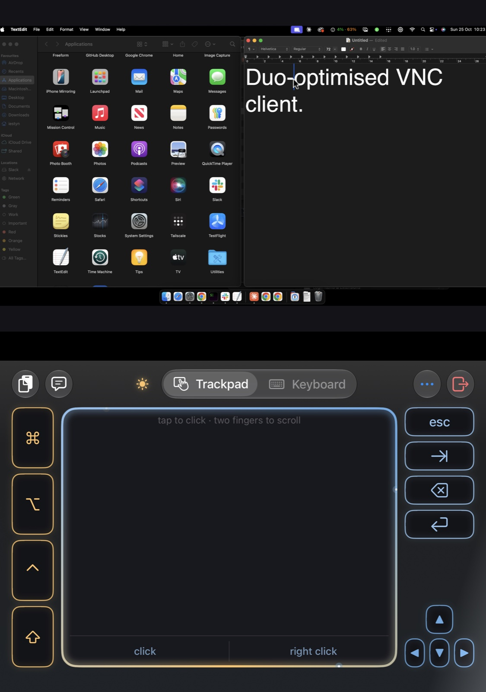
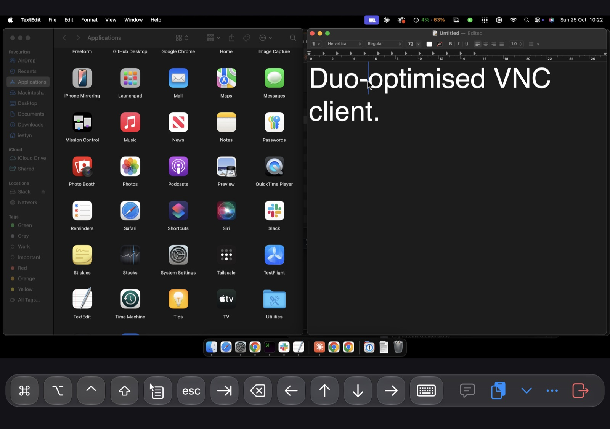
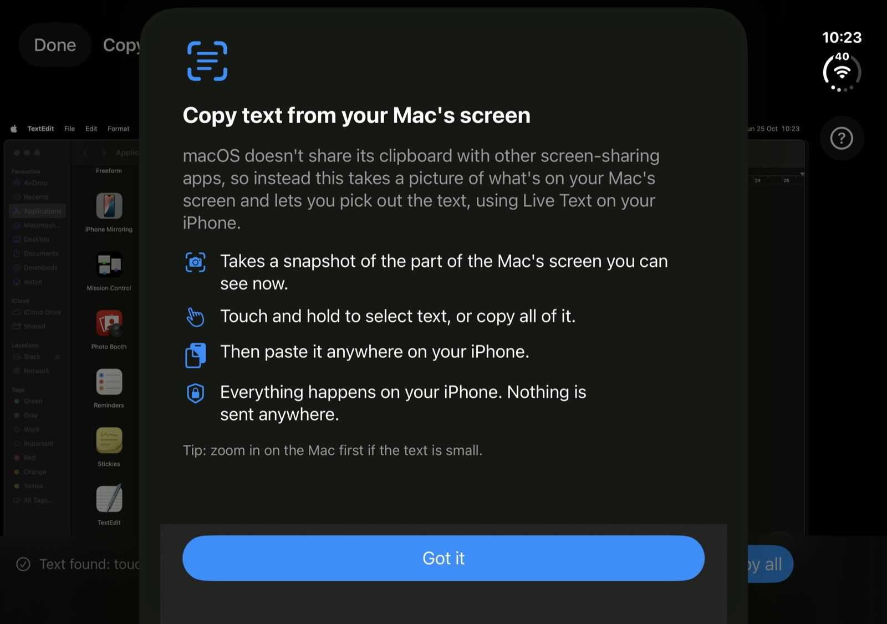
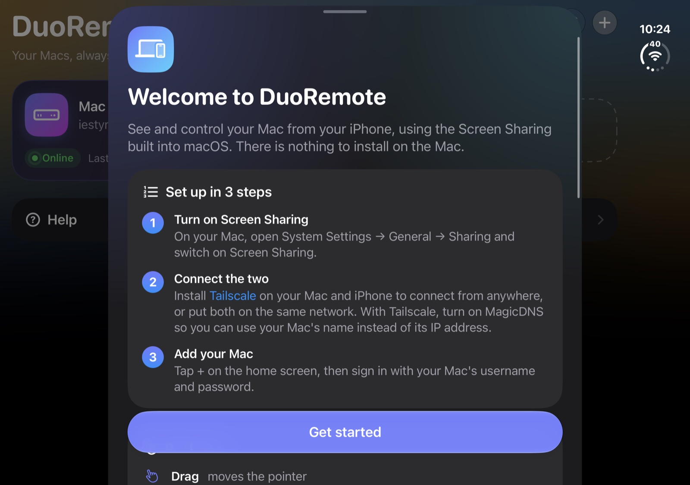

# DuoRemote

Control your Mac from your iPhone, built for the iPhone Duo. Uses the Screen Sharing already built into macOS, so there's nothing to install on the Mac.

- **Copy text off the Mac's screen.** macOS won't share its clipboard with non-Apple screen-sharing apps, so the app reads the Mac's screen with Live Text, right on the phone, and you select and copy what you need.
- **Laptop pose on iPhone Duo.** Fold it halfway and it becomes a tiny laptop: the Mac's screen on top, a trackpad, modifier keys and the keyboard below. Open it flat and the Mac gets the whole screen again.
- **A proper trackpad.** Tap to click, two fingers to scroll (with momentum) or right-click, hold to drag, pinch to zoom, and a magnifier while you drag. Or switch to direct touch.
- **Typing that works.** A text box with dictation and autocorrect (and a lock for passwords), sticky ⌘ ⌥ ⌃ ⇧, and hardware keyboards passed straight through.
- **Paste to Mac.** Types your iPhone's clipboard into whatever has focus on the Mac, without accidentally pressing Return.
- **Careful with your password.** Kept in the iPhone's Keychain, and sent automatically only when the Mac is reached through Tailscale. No accounts, no analytics, no servers.
- **Colours that follow the sky.** The deck glows in the colours of the time of day where you are, with stars at night. Or turn the effects off.

<p align="center">
  
  
</p>
<p align="center">
  
  
</p>

> [!NOTE]
> **Heads up:** I built this for myself, for my own use, with [Claude](https://claude.ai). It does what I need and isn't a polished product. If something doesn't work the way you want, please fix it in the code — that's the point of sharing it. Issues and pull requests are welcome, but I can't promise support.

> [!WARNING]
> **Use at your own risk.** This software is provided as-is, with no warranty of any kind, and to the extent permitted by law I'm not responsible for anything that happens from using it — including data loss, security problems, or damage to your devices or your Macs. It controls your Mac remotely and handles your Mac's password, so before you build or use it, read the code yourself and do your own security review. See [Security](#security) for what it does and doesn't protect, and the [LICENSE](LICENSE) for the full terms. Only use it to control computers you own or are authorised to access.

It's designed to work over [Tailscale](https://tailscale.com) or a network you trust. A welcome sheet in the app covers setup, gestures and the points below.

## All features

- **Trackpad or direct touch.** Drag to move the pointer, tap to click, two-finger tap to right-click, two-finger drag to scroll (with momentum), hold then drag to drag, pinch to zoom, three-finger drag to pan. A magnifier appears while you drag, for precise targets.
- **Key bar.** Sticky ⌘ ⌥ ⌃ ⇧ (tap to latch, double-tap to lock), Esc, Tab, Delete, arrows, right-click, and the iOS keyboard. Hardware keyboards pass straight through.
- **Text box.** A real iOS text field (with dictation) that types into the Mac. Return sends and presses Return; ↑ sends without it. It opens by itself when you click into text on the Mac (turn that off in ••• or Settings); once you close it, it stays closed until the pointer leaves the text.
- **Paste to Mac.** Types your iPhone clipboard into whatever has focus on the Mac. Line breaks become Shift-Return so nothing gets submitted by accident.
- **Copy text from screen.** macOS doesn't share its clipboard with non-Apple screen-sharing apps, so this snapshots the Mac's screen and lets you select text with iOS Live Text, on the phone.
- **iPhone Duo.** Adapts to the outer and inner displays and the fold. In laptop pose (half-open, fold across) the Mac's screen is on top and a deck below has a trackpad with click zones, modifiers, keys and a Trackpad/Keyboard switch.
- **Look and feel.** Deck colours follow the sky at your location (no location permission; estimated from the time zone), with a gentle shimmer, and stars at night. Connect, reconnect and click effects. Turn everything off with the ☀/☾ button or in Settings.
- **Scroll speed.** A default in Settings, and a per-Mac override from ••• → Scroll speed while connected.
- **iPad.** Works with an iPad keyboard's trackpad or a mouse: the Mac's pointer follows yours, clicks and right-clicks are real button presses, and two-finger scrolling and pinching work as you'd expect.
- **Hosts.** Saved Macs with live online status, Keychain passwords, and automatic reconnect after the phone sleeps or the connection drops.
- **Diagnostics.** ••• → Connection log; crash and hang reports (MetricKit) shareable from the hosts screen.

## Requirements

- iOS or iPadOS 27.1 or later: iPhone (including iPhone Duo) or iPad
- A Mac with Screen Sharing turned on (System Settings → General → Sharing)
- Tailscale on both devices, or both on the same network. With Tailscale, turn on [MagicDNS](https://tailscale.com/kb/1081/magicdns) so you can connect by the Mac's name (e.g. `my-mac`) instead of its IP address.
- To build: Xcode 27

## Security

- macOS Screen Sharing does not encrypt the screen contents or your keystrokes beyond the sign-in. Use Tailscale or a network you trust.
- The app cannot verify the identity of the Mac it connects to. If you connect outside Tailscale, a fake server on that network could capture your Mac's password.
- A saved password is sent automatically only when the Mac is reached through Tailscale (its name resolves to Tailscale addresses that are routed through the Tailscale tunnel), and only to a macOS sign-in. Otherwise the app warns and asks first. "Allow outside Tailscale" in Edit Mac turns this off for one Mac, and also allows Macs that ask for a plain VNC password.
- Passwords are stored only in this iPhone's Keychain.
- No accounts, no analytics, no servers. The app talks only to the Macs you add.
- The app reads the iPhone clipboard only when you tap Paste, and iOS asks first ("Allow Paste"). Text from the Mac's clipboard and Copy text from screen's Copy all stay on this iPhone (no Handoff) and expire after 10 minutes; Live Text's own Copy menu works like any other copy.
- Copy text from screen runs Live Text on the phone; the snapshot never leaves it.
- The app switcher shows a blank cover instead of the app, including any open sheet.
- Third-party keyboards are turned off in the app. The text box's lock button hides what you type and turns off autocorrect and suggestions, for typing passwords.
- Paste to Mac types the text. Line breaks are typed as Shift-Return so nothing is submitted, but some apps, such as Terminal, treat Shift-Return as Return. Text with line breaks or over 2,000 characters asks first.

## Building

You need a Mac with Xcode 27 and an iPhone or iPad running iOS/iPadOS 27.1 or later. A free Apple account is enough to run it on your own phone.

1. Clone the repo and open `DuoRemote.xcodeproj` in Xcode.
2. Select the **DuoRemote** project in the sidebar, then the **DuoRemote** target → **Signing & Capabilities**.
3. Choose your **Team**, and change the **Bundle Identifier** to something unique to you (e.g. `com.yourname.duoremote`).
4. Connect your iPhone or iPad, choose it as the run destination at the top of the window, and press **Run** (⌘R).
5. The first time, the iPhone asks you to trust the developer: **Settings → General → VPN & Device Management**, then your Apple account.

To keep your signing settings out of git, you can instead create `Config/Local.xcconfig` (the `Config/` folder is already there; git ignores this file) with:

```
DEVELOPMENT_TEAM = YOURTEAMID
APP_BUNDLE_ID = com.yourname.duoremote
```

To try it without a device, choose any iOS 27.1+ simulator as the run destination; the simulator needs no signing.

Run the tests with **Product → Test** (⌘U). They use Swift Testing and need no network or Mac.

Metal shaders are compiled when the app runs, so you don't need to download the Metal Toolchain.

## Third-party notices

- [RoyalVNCKit](https://github.com/royalapplications/royalvnc) 1.1.0, MIT licensed, vendored in `Vendor/RoyalVNCKit` with patches listed in `Vendor/RoyalVNCKit/PATCHES.md`. Its license is in `Vendor/RoyalVNCKit/LICENSE`.
- [CryptoSwift](https://github.com/krzyzanowskim/CryptoSwift), used by RoyalVNCKit (royalapplications fork). Copyright (C) 2014-3099 Marcin Krzyżanowski. This product includes software developed by the "Marcin Krzyzanowski" (http://krzyzanowskim.com/).
- D3DES by Richard Outerbridge (public domain), with changes © 1998 Olivetti & Oracle Research Laboratory, included in RoyalVNCKit.

The full licence texts are in [THIRD_PARTY_NOTICES.md](THIRD_PARTY_NOTICES.md), and in the app under Settings → Acknowledgements.

This is an independent project and is not affiliated with, sponsored or endorsed by Apple Inc. or Tailscale Inc. Apple, iPhone, Mac, macOS, Live Text, TestFlight and Xcode are trademarks of Apple Inc., registered in the U.S. and other countries and regions. Tailscale is a trademark of Tailscale Inc. Other names are the property of their owners. Provided as-is, with no warranty. Use at your own risk.
